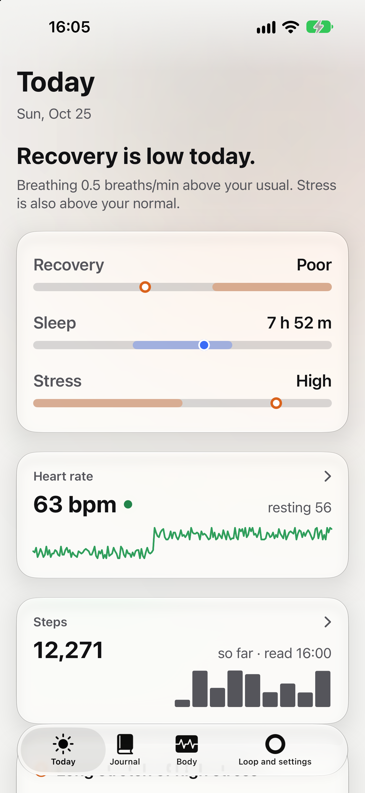
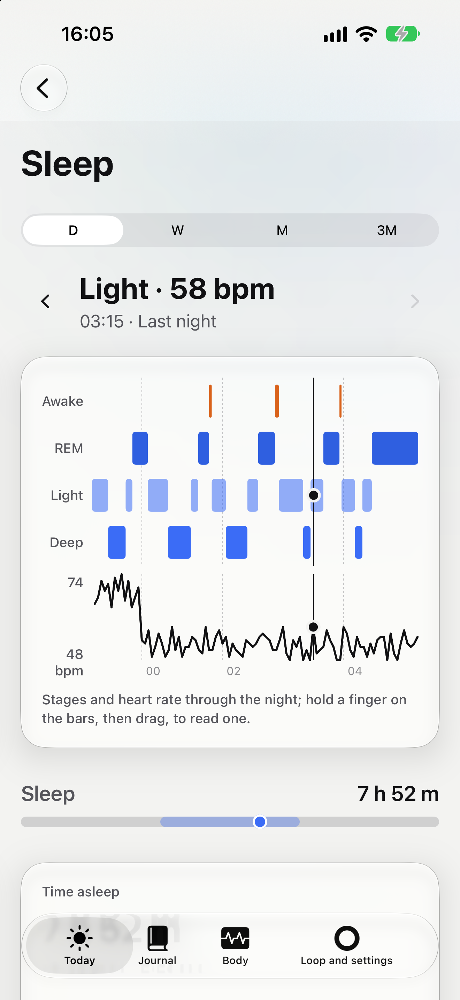
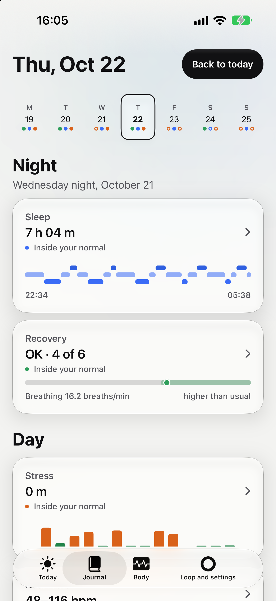
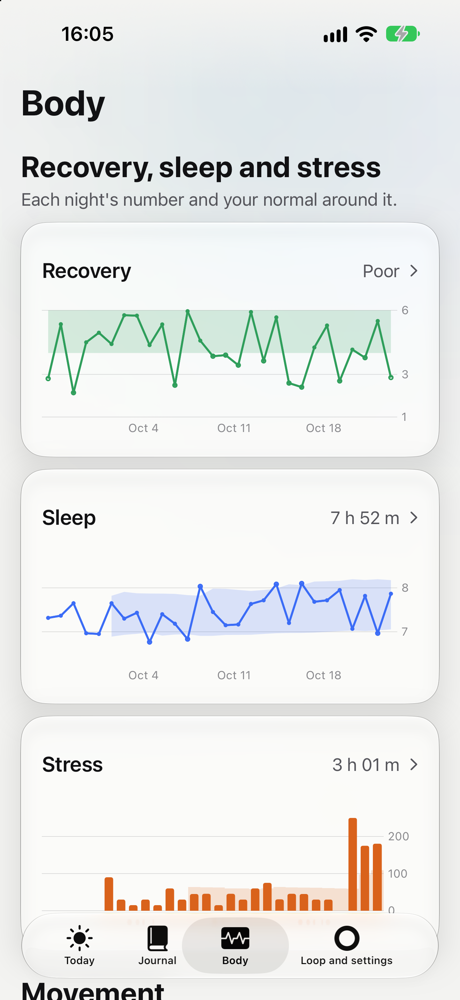
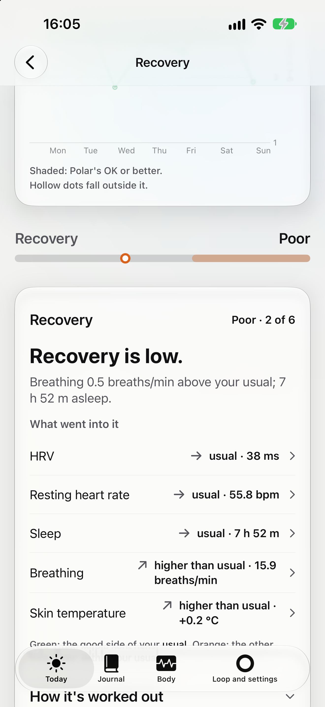
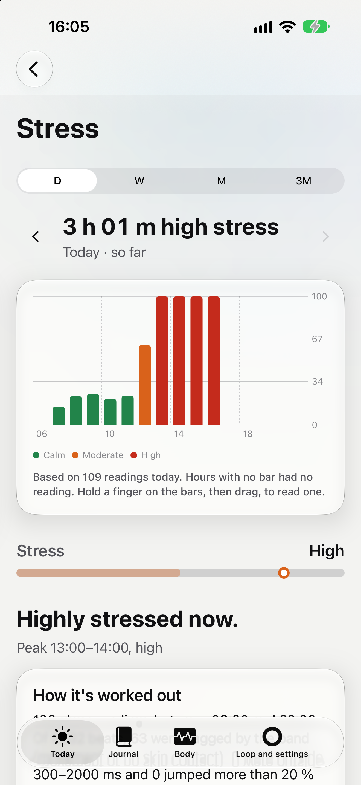
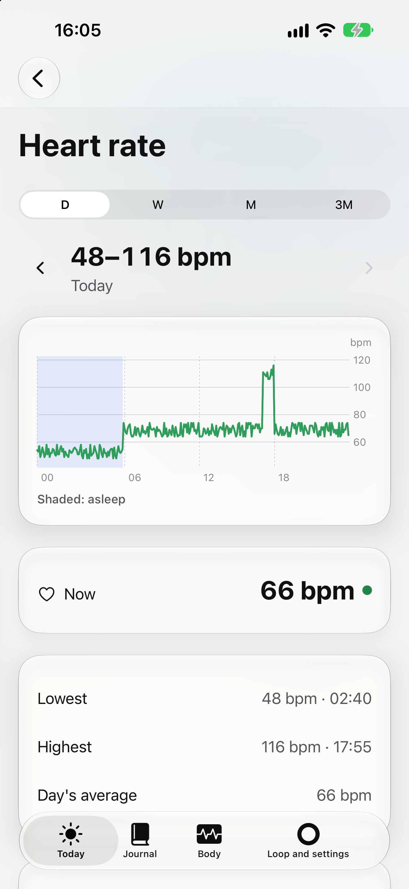

# Vesel

A quiet iPhone health assistant. It reads your band over Bluetooth, works in the background, and speaks up only when your sleep, recovery or stress is off. Your data stays on your phone and your own Mac.

Built for one person running their own copy. Not a product: no App Store, no accounts, no shared server.

## Status

Used daily by its author on one iPhone and one Polar Loop since October 2026. Any feature not yet checked on real hardware is marked in its page in [docs/how-it-works/](docs/how-it-works/).

<p>
  
  
  
  
</p>
<p>
  
  
  
</p>

## What you need

- An iPhone on iOS 26.
- A Mac with Xcode 27 or later (macOS 27 for the Vesel Backup app) and [Homebrew](https://brew.sh).
- An Apple Developer team, to install it on your iPhone. The Simulator needs none.
- Optional: a Mac at home for the backup.
- The band: a Polar Loop. Vesel is built on Polar's BLE SDK, under its own licence ([THIRD_PARTY_NOTICES.md](THIRD_PARTY_NOTICES.md)).
- Not affiliated with or endorsed by Polar Electro.
- Not a medical device. Vesel doesn't diagnose, treat or prevent anything; it shows what your band measured and what that usually means.

## Build

1. Install the tools:
   ```
   brew install xcodegen uv
   ```
2. Run it in the Simulator, on a fake band with made-up data. No team needed:
   ```
   cd ios && xcodegen generate
   xcodebuild -project Vesel.xcodeproj -scheme Vesel -destination 'generic/platform=iOS Simulator' -derivedDataPath build build
   xcrun simctl boot 'iPhone 17 Pro Max'; open -a Simulator
   xcrun simctl install 'iPhone 17 Pro Max' build/Build/Products/Debug-iphonesimulator/Vesel.app
   xcrun simctl launch 'iPhone 17 Pro Max' app.vesel.ios -VeselScenario normal -VeselNow 2026-10-25T15:00:00Z
   ```
   `-VeselNow` moves the app's clock to the last day of the fake data. With your own `VESEL_BUNDLE_PREFIX` (step 3), launch `<prefix>.ios` instead of `app.vesel.ios`. Any iPhone Simulator works: `xcrun simctl list devices` shows yours. Or open `ios/Vesel.xcodeproj` in Xcode and press Run.
3. To install on your iPhone, create `Signing.local.xcconfig` next to `Signing.xcconfig` at the repo root. It is gitignored:
   ```
   DEVELOPMENT_TEAM = <your team id>
   VESEL_BUNDLE_PREFIX = <your reverse domain>
   CODE_SIGN_IDENTITY[sdk=macosx*] = Apple Development
   ```
   The prefix gives your own bundle ids and App Group (`<prefix>.ios`, `group.<prefix>.ios`). Run `cd ios && xcodegen generate` again, open `ios/Vesel.xcodeproj`, pick your iPhone and press Run.
4. The Mac backup app: `cd mac && xcodegen generate`, open `mac/VeselBackup.xcodeproj` and press Run.
5. The backup server, both ways of running it: [server/README.md](server/README.md).

## What's where

| Folder | What |
|---|---|
| `ios/` | The iPhone app, its widgets and its Swift packages |
| `mac/` | Vesel Backup, the Mac menu bar app that runs the backup server |
| `server/` | The Python backup server, run by the Mac app or set up in Terminal |
| `docs/` | Why it exists, how it works, the decisions. Start at [docs/README.md](docs/README.md) |

How the project is worked on, and the checks: [CONTRIBUTING.md](CONTRIBUTING.md). Security reports: [SECURITY.md](SECURITY.md).

## Built with

[Built with Solid Vibes](https://solidvibes.stojanovventures.com).

## Licence

Copyright 2026 Solid Vibes, a brand of Stojanov Ventures UG (haftungsbeschränkt) (https://stojanovventures.com)

Open source under the [Apache License 2.0](LICENSE). Keep [NOTICE](NOTICE) with any copy you share. The Polar BLE SDK stays under Polar's own licence ([THIRD_PARTY_NOTICES.md](THIRD_PARTY_NOTICES.md)).
