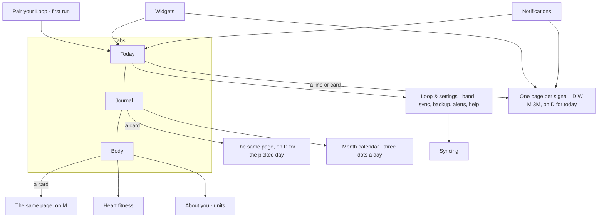
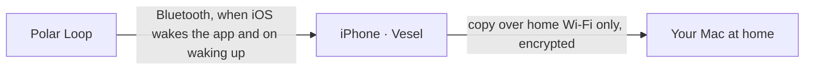

# Screens

Approved 2026-10-26. Drawings: the "Vesel Direction" design canvas (private artifact).

## Map



Three tabs in a floating glass tab bar: Today (sun), Journal (closed book), Body (an ECG pulse line in a rectangle, `waveform.path.ecg.rectangle`: SF Symbols has no heart with a pulse, and this is its closest true match). Beside the bar, at its trailing end, a separate round button (iOS 26's trailing tab, `Tab(role: .search)`) draws the app icon's single ring and opens Loop & settings on Today. While a read runs in the foreground a bold quarter of the ring turns smoothly, once every 1.2 s (one animated image the tab bar plays on its own, so nothing else redraws; Reduce Motion: the ring is dimmed); VoiceOver says "Loop and settings", value "Reading". When the Loop's battery is below 20 % the ring is drawn in the stress colour (turning or still), its VoiceOver value adds "Battery low", and Loop & settings' Battery row reads "18 % · Low"; it shows the battery as of the last read, so it clears at the first read after charging. No notification, nothing on Today. Each has its own stack; the pages are registered on all three. Back always works. Main actions sit in the lower half. Every tab and Loop & settings fade the page colour in under the clock (never takes a tap). A "How it's worked out" row opens in place: its chevron turns and the sentence grows in below it (no animation with Reduce Motion).

One short form (Today), one full page, links elsewhere: a thing is shown in full on its page only; other screens link to it.

## Today

What it's for: "how am I doing right now?" at a glance. The app opens here. Always today: it has no calendar and no past days (those are Journal's).

- Top to bottom: the title "Today" and the date, the "Good morning — I'm up" card (or "Evaluating your night"), the headline, the three range lines on one glass card, the Heart rate card, the Steps card, alert cards, and last the reading card (or the can't-reach card), so it appearing and folding away never moves a card above it.
- Steps card (one button, opens the Steps page for today): "Steps" and a chevron; today's count in title size with "so far · read 14:32" beside it (the time the band was last read for today's steps; "so far" alone if no read time exists); "No steps yet today" with none; under the count, today's bars per hour so far (muted colour, 44 pt, from 00:00 to now, at least one hour wide, not touchable, nothing when there are no steps by the hour). No goal, no comparison. VoiceOver: "Steps, 6,240, so far · read 14:32", hint "Opens Steps".
- Workout lines (Planned, `docs/how-it-works/workouts.md`): under the Steps card, one glass row per workout started today, "Run · 07:10 · 42 m · Moderate" with the sport's icon and a chevron, opening the Workout page. Nothing with none. The headline names yesterday's moderate or hard workout when recovery is off ("Low recovery after yesterday's hard ride.").
- Alert cards; "See what changed" opens the page: low recovery and unusual resting heart rate open Recovery, long high stress opens Stress.
- Headline sentence + one line of why (`headline` v3 covers recovery, sleep and stress; "Everything looks great today." on a good day; with no night stored but stress judged, "No sleep recorded last night." and the Stress line).
- Three range lines (name left and value right in title3 semibold, the line under): Recovery, Sleep and Stress, each a button that opens its page for today. While a line is learning, its first-week row of checks (name, "3 more nights · Sun", a circle per night or day) takes its place, under "Getting to know you.".
- Heart rate card (one button, opens the Heart rate page for today): "Heart rate" and a chevron; the live bpm with the pulsing green dot while the stream runs ("Check the fit" without skin contact; else the latest stored reading with its time; "No heart rate yet today" with none); "resting 54" from last night once it is in; a small line of today's 5-minute heart rate so far (no axes, no scrubbing). VoiceOver reads it as one: "Heart rate, 61 bpm, live, resting 54 bpm, today so far 52 to 118 bpm".

States: normal; something's off (alert card under the Heart rate card, a quiet warm glow at the top, "See what changed"); first day (learning your normal, night 0 of 7); reading from the Loop (only the first read after the app comes to the foreground, and only when it is still running after about a second: the last numbers faded and the reading card at the bottom: Loop found, Heart rate with the green pulsing dot while it is read, Last night N of 3 parts (only while last night isn't on the phone when the read starts), Stress today; it folds away when done; a later read while the app stays open, or one in the background, changes nothing on the page: only the ring turns; the very first read, with nothing stored yet, shows the list alone); can't reach the Loop (only after Sync now or Try again ran out of time: error card at the bottom with Try again and under its message a quiet row "Last read at 08:12 ›", or "Syncing ›" before the first read, that opens Syncing; yesterday's numbers dimmed below); waiting for the Loop (a read waits up to 60 seconds for it: a calm "Waiting for your Loop · Reads as soon as it's near your phone." card with a thin moving line where the error card goes, numbers below as they are; no error after an automatic read); good morning (until last night is stored, the band still records sleep or it's 03:00–12:00: a "Good morning — I'm up" card with "Still in bed" to hide it for this morning; Recovery and Sleep say "Evaluating…" instead of showing the night before); evaluating your night (Built, phase 1 of `docs/plans/2026-10-30-calmer-morning.md`: from the "I'm up" tap, or the Loop ending the night itself, until last night is stored, one "Evaluating your night" card with "Nothing for you to do. We'll let you know when it's ready." (once a read didn't find the Loop for the tap: "Nothing for you to do. Your Loop gets the message as soon as it's near your phone."; with the morning report off: "Nothing for you to do. It shows here when it's ready.") and a thin moving line under it, still with Reduce Motion; Recovery and Sleep say "Evaluating…"; "I'm up" hides on tap and never says "Couldn't reach your Loop"; after "Still in bed" no card while the Loop records; once last night is stored neither card shows).

## Journal

What it's for: what happened on any day. Its day is the shared day (`docs/how-it-works/days.md`).

- Top: the title is the day's date ("Tue, Oct 27", also on today); it is a button for VoiceOver, not drawn as one, and opens the month calendar (three dots per day; its bottom button reads "Today"). On a past day an ink "Back to today" pill sits beside it.
- A week strip under it once there is data: seven days (weekday letter, date, three dots: recovery, sleep, stress), the picked day highlighted; pages end on today (today and the six days before it, then the week before that), so today's page is always full; tap a day to pick it, swipe to move a week. Each day is one VoiceOver button (same words as the calendar); "Earlier week" / "Later week" are VoiceOver actions and scroll gestures. At the largest text sizes the weekday letters drop.
- **Night**, with the evening the night began ("Monday night, October 26"): two cards, Sleep (time asleep; under it a 44 pt strip of the night's stages with bedtime and wake time at its ends) and Recovery (Polar's word and "N of 6"; under it the recovery range line and the contributor furthest from your usual, else HRV: "HRV 46 ms" left, "usual" right). Empty: "No sleep recorded this night" (today: "No sleep recorded yet") and "Polar hasn't scored this night yet".
- **Workouts** (Planned): between Night and Day, only when the day had one: a card per workout in time order: sport icon and word, "07:10–07:52", "42 m · Moderate", and a 44 pt heart-rate line in workout purple. One button, opens the Workout page. VoiceOver: "Run, 07:10 to 07:52, 42 minutes, moderate effort".
- **Day**: two cards, Stress (high-stress time; today "8 m so far · Calm now"; "No stress readings" with none; under it the day's hourly bars, as on the page but 48 pt, no axes) and Heart rate (the day's lowest to highest, "48–121 bpm"; under it a 44 pt line of the day's 5-minute heart rate, 00:00 to 24:00). No live number: that is Today's.
- A **Steps** card ends the Day section when the day has steps: label "Steps", the day's total ("8,850", "8,850 so far" today), a chevron, and small bars per hour with "00:00" and "24:00" under them (like the Heart rate glance); it opens the Steps page for that day. No card with no steps; no bars with no hourly samples.
- Steps' card opens the Steps page (see "The pages"); no goal, no busiest hour, no best.
- Each chart is part of its card's one VoiceOver element: the value, then a short summary ("asleep 22:50 to 06:40", "HRV 46 ms, usual", "Peak 14:00–15:00, high", "lowest 48 at 03:10, highest 121 at 17:30"). The charts take no touches; the whole card opens its page.
- A card is one button (48 pt minimum): its name, its value, where it sits against your normal as a dot and its word ("Inside your normal"; never colour alone) and a chevron. It opens the same page Today opens, for the picked day. Journal shows a dot and its word; only Recovery draws its line.
- Nothing spans weeks. A later section for adding things to a day would follow Day (a later idea); nothing is built for it.

States: full; no sleep recorded (no strip); sleep without a recharge score (no line); a day with no stress readings (no bars); a day with no heart rate (no line).

## The pages

Recovery, Sleep, Stress, Heart rate, Steps, HRV, Resting HR, Lowest HR, Breathing and Skin temperature. One page for each, the same whether it is opened from Today, Journal or Body (`docs/decisions/2026-10-28-one-page-per-signal.md`), shaped like Apple Health's Steps page. Pushed over the tab; its day and period are in the route, so a page never reads the shared day.

```
Title (opens its meaning)
[ D | W | M | 3M ]
‹  Header: the big value             ›    a finger on the chart replaces it
   date, or date range (muted)
CHART
caption (W, M, 3M: "Shaded: your normal, from the 4 weeks before each night")
D: the day's cards      W, M, 3M: "How it's worked out" for the latest day
```

- **Header:** on D the day's number and its date ("7 h 40 m asleep · Last night", "45 m high stress · Today · so far", "12,481 steps"); on W, M and 3M a small "Average a night" (steps: "Average a day") over the plain average, with the date range under it ("7 h 12 m · Oct 21 – 27"); Heart rate shows the lowest to highest; Recovery the most frequent word. A finger on the chart swaps it for the touched bar or point and its time or date; lifting restores it. Left and right, ‹ › buttons ("Earlier day", "Later week") move one period; › is off at today and ‹ before the first day with data.
- **Gestures:** the title and the switch stay still; under them the period content (‹ value › header, chart, cards) is one of a row of pages, one per period, from the first day with data to today, edge to edge with no gap between pages beyond each page's own side margins. A sideways drag anywhere on it, the chart included, slides it to the earlier or later period with the neighbour under the finger, already showing its data, bouncing at today and at the first period; the page keeps its scroll position across a swipe. Hold a finger on the chart for a moment, then drag, to read it (a light tick on each new bar); the chart has no swipe of its own. A tap on a day in W, M or 3M opens D on it. A vertical scroll that starts on the chart still scrolls the page; the swipe from the screen's left edge goes back. ‹ › move the row one period (no slide with Reduce Motion); the switch changes the view as before. Today's and Journal's small charts read at once and only open the page.
- **Title in the bar:** once the big title scrolls under the top bar, the same title fades into the bar beside back while the big one fades out, so only one shows through the bar (no fade with Reduce Motion); content scrolled under the bar is cut off at its edge, never readable behind the title, and back again when scrolled back; after a swipe it matches the page shown. Heart fitness does the same.
- **D charts:** Steps and Stress hourly bars (the other bars dim); Heart rate the 5-minute line with sleep shaded; Sleep the stages with the overnight heart-rate line; Recovery and the overnight signals the 7 nights ending on that night, that night full and the rest faded. W, M and 3M draw the moving normal as a shaded band behind each point (dots outside it hollow; before 7 nights a dashed line at the median so far; Sleep is blue bars from 0 over its shaded normal, like Steps (Built, phase 3 of `docs/plans/2026-10-30-calmer-morning.md`)); Heart rate draws a lowest-to-highest bar per day, no band. Caption on D charts: "hold a finger on the bars, then drag, to read one".
- VoiceOver: the picker reads Day, Week, 4 weeks, 3 months; the chart is one adjustable element (1 hour on hourly bars, 15 minutes on lines and stages, a day on W, M, 3M) with a "Show this day" action on W, M, 3M. Largest text sizes: taller charts, side numbers dropped.
- On D under the chart, per signal (the day's range line, where it has one, comes first):

- **Recovery:** the recovery card: "Recovery" (opens its meaning) with Polar's verdict in words and "N of 6" on the right (empty while Polar hasn't scored the night), the sentence and the one why line, then "What went into it": a row per contributor with its word against your usual and value ("higher than usual · 48 ms") and an arrow; the arrow is green on its good side, orange on the other, grey within your usual, the words stay in text colour for contrast (breathing and skin temperature always grey; words and arrows always show). A one-line key under the rows ("usual" is a term link). A row opens the meaning sheet with the night's number and a "Night by night" button that opens that contributor's page on M. "How it's worked out" at the bottom opens in place. Under the card: "What tends to help" when something was off.
- **Sleep:** duration, times, efficiency and the "Your normal" row (the stage rows and Time asleep open a meaning sheet); the stages chart with the overnight heart-rate line under it sits on top, under the header (hold a finger on either, then drag: a line, and the header reads "03:12 · Deep · 51 bpm"; VoiceOver swipes up/down in 15-minute steps); HRV, lowest HR and breathing each open their own page on D for that night. Then "What tends to help" after a short or a long night.
- **Stress:** the hourly bars (calm / moderate / high) sit on top, under the header ("45 m high stress"; hold, then drag: "14:00–15:00 · High, 72"; the title opens what stress means); then the headline ("Calm now." / a past day "45 m of high stress.") and the peak window; "How it's worked out" with Your normal, then "What tends to help" when stress was above your normal. While learning: the learning wording and why.
- **Heart rate:** for today a "Now" row on top (the live reading with the pulsing green dot, else the latest stored reading with its time, "Check the fit" without skin contact); the day's 5-minute line with sleep shaded (drag a finger for "14:05 · 72 bpm"), Lowest, Highest, Day's average, and "How it's worked out".

- **Workout blocks** (Planned): on D, the Heart rate line and the Stress bars (and their glances on Today and Journal) draw each workout's time as a purple block behind the marks; a finger inside it adds the sport to the header ("14:05 · 142 bpm · Ride"); VoiceOver adds "during a ride". None on W, M, 3M.

**What tends to help** (Recovery, Sleep, Stress; `docs/how-it-works/what-helps.md`): a glass card with 3 to 5 bulleted tips and the line "General advice for most people, not medical advice."; only when that page had something off, past days too; never on Today, widgets or notifications. Page order: the day's content (ending with its "How it's worked out") → What tends to help.

States: full; no sleep recorded (yet); sleep without a recharge score; learning your normal; a day with no readings; something off (with the advice card).

## Workout page (Planned)

What it's for: one workout, explained. Opened from a Journal card or Today's workout line; pushed on that tab's stack. Not a signal page: no D · W · M · 3M, no comparison with other workouts.

- Title: the sport word (opens what a workout means), and when it was guessed a chip beside it, "guessed from speed · change" or "guessed from time of day · change"; under it "Tue, Nov 3 · 07:10–07:52".
- With a route: a 200 pt map with the route in workout purple (no places, no interaction), then "8.4 km · 11.9 km/h average" (mi and mph with US units).
- Heart rate: the workout's line (hold, then drag: "07:31 · 152 bpm"), then Average and Highest rows.
- Effort: "Moderate · 87"; tap opens the meaning sheet with where the number came from. No row when the Loop gave no load.
- Calories. For a swim, "Heart rate at the wrist is less exact in water."
- How it's worked out (opens in place).
- The sport sheet (from the chip or the title): your sports, then "Not a workout" (it hides the workout and goes back). The choice stays.

States: with a route; without; guessed sport; band's sport; no effort; swim.

## Body

What it's for: how am I changing. Every card shows the last 4 weeks and opens the signal's page on M; there is no period switch on Body, it lives on the page. Cards in three groups, each with its heading and one line: **Recovery, sleep and stress** ("Each night's number and your normal around it."): Recovery (Polar's 1–6), Sleep (hours asleep, as blue bars from 0 over the shaded normal), Stress (high-stress minutes a day, as bars); **Movement** ("How much you move each day, and your normal around it."): Steps (the day's steps as bars in the muted text colour over the shaded normal, today's bar lighter because the day isn't over; under the chart "Your normal 7,100–11,300 a day. Today's bar is lighter: the day isn't over."; the card's value is the latest day, "6,240 steps"; days with no steps are gaps; learning wording "Your usual range appears after 7 days · N of 7"); **Overnight** ("What your Loop measured while you slept."): HRV, Resting heart rate, Lowest heart rate, Breathing, Skin temperature (the mean during sleep, in the chosen units). A card is its title (opens what it means in a sheet), the latest night's value with a chevron and a 120 pt chart of the whole range: a faint grid, 3 numbers on the trailing side and dates along the bottom (every 7th day on 4 weeks). The chart is a line with a dot per night (Stress and Sleep: bars) over a shaded band that follows each night's own normal: for each night, low…high of the 28 nights before it. A night with no number is a gap; a night with no normal yet (the first 7) has no band. While a measure is learning, "Your usual range appears after 7 nights · N of 7" sits under its chart. VoiceOver reads the title, the latest value and "your normal now 34–52 ms". The value and chart open the signal's page on M.

Heart fitness (after the groups, no range) is a card with its title (opens what Heart fitness means; the card body opens the page), the band in words ("Younger than your age" / "About your age" / "Older than your age"), a small still scale with the marker settled in the band, and "October · worked out 1 Nov" in muted text; while there is too little data, the learning line ("Heart fitness is worked out on the 1st of each month, once a month has 7 nights and 14 days with your Loop. Next: 1 Nov."), and outside ages 20–90 "Heart fitness is made for ages 20 to 90." The card opens a page: title, the month, the band in large type over a scale (Younger · About your age · Older) where a marker slides in from the left and settles in the band with a soft green glow (no slide with Reduce Motion; at the largest text sizes the labels become a list with a check mark), then, in the same card, three short lines (what it means, why a band and not an age, how often it updates), then Resting heart rate · Exercise days a week, a VO2max card: "Vesel's estimate · about 50 ml/kg/min" with "An estimate, often off by 5 or more either way", and, only when About you has one, "From your other device · 46 ml/kg/min" with "Different methods: your other device works it out from your heart rate during exercise; Vesel estimates from your body, resting heart rate and exercise habits." (no arrows, no verdict), two short limits lines and "How it's worked out", which opens with the body measure used ("Waist: 84 cm. Waist helps estimate your heart fitness. It stays on this phone." or the BMI line). No age, no change from last month. VoiceOver reads "Heart fitness: younger than your age". The page title is the same title, and opens the same meaning.

About you (last): the heading and one line ("What Vesel knows about you, and how numbers are written."), then a card: first a Units switch (Metric | US, segmented like the sex switch; saves at once, never sent to the Loop), then height, weight, birth year, sex, sleep goal, waist, VO2max from another device, in the chosen units ("5 ft 11 in", "165 lb", "33 in"; "Not set" when blank). Each row pushes the About you editor on Body's stack: all fields, in US height as two fields "ft" and "in" and "Weight (lb)", the last two optional ("Optional" placeholder; "Waist (cm)" 50–200, or "Waist (in)" 20–78, with "Measured around your belly button. Waist helps estimate your heart fitness. It stays on this phone.", "VO2max from another device (ml/kg/min)" 10–90 with "e.g. from a Garmin watch"), Save top right, disabled until something changed and every field is valid; one line "Saving sends these to your Loop, except waist and VO2max. Your Loop may take a few nights to settle its recovery again."; a change to only waist or VO2max saves on the phone without the Loop; "Saving to your Loop…" while it writes; on failure a "Not saved" card on top with Try again, the edit kept.

States: full; learning (no band yet, the learning wording); no data yet ("Body starts after your first night with the Loop.").

## Loop & settings

Opened from the round ring button at the end of the tab bar (pushed on Today's stack); back to Today. Band status (connection, battery). Sync: a "Syncing" row showing "Last read 9 hours ago" with a chevron (opens Syncing), Mac backup, band storage. Workouts (Planned): one row, "Workouts" with "On" or "Off", opening Workouts settings: Notice workouts by itself, Sensitivity (slider, "Fewer" … "More easily"), Shortest workout, Record my route (with "Location is off for Vesel in iOS Settings" and Open Settings when it is), Your sports (Running, Cycling, Swimming, Strength); a band change that didn't save shows the "Not saved" card. Alerts: low recovery, long high stress, unusual resting HR, morning sleep report (each a switch). Help: one row, "What things mean", opening the glossary list (every term, grouped Sleep · Recovery · Heart · Stress · About the readings; a row opens the meaning sheet). Mac backup settings. Forget this Loop (destructive). Sync now and its error card live on Syncing.

## Meaning sheet

One bottom sheet for every title or word with a meaning (`vesel-term:` link). Medium and large, large only at the largest text sizes; scrolls; Done top right. Order: the term's title; What it is · Good or bad · A lot or a little · What's normal · What affects it (an entry may use others); a "Yours" glass card with the screen's own line for the day shown (not from the list or a word link); How the band knows; "How it's worked out" folded, opening in place with the number's text, method and version. No info buttons and no underlines: titles open their meaning when tapped, and a word link in running text is in the link colour.

## Syncing

What it's for: seeing why the Loop isn't syncing, and forcing a sync. Pushed from Loop & settings' Syncing row and from Today's "Last read at … ›" row. Top to bottom: "Last read 9 hours ago" (title size; "Last read just now" under a minute, "Not read yet" before the first read), under it only when the newest finished try failed "Vesel hasn't reached your Loop since 08:12. It tried 3 times." (never read: "Vesel hasn't read your Loop yet."); Sync now (secondary, spinner while it runs) and, after a failed Sync now, the "Couldn't reach your Loop" / "The read didn't finish" card; an "If it's stuck" card with five numbered steps and the line "Nothing is lost for now: …"; "Recent syncs", the 20 newest grouped under Today / Yesterday / the date, each row "17:20 · you opened Vesel" left and its ending right ("done", "Loop not nearby", "reading now…") with a checkmark, exclamation or clock icon so colour never carries it. No health values, and the stored detail is never shown.

States: normal (rows "done"); can't reach (trouble line, "Loop not nearby" rows); never read; a sync running (newest row "reading now…").

## Pairing (first run)

1. Before you start: explains direct Bluetooth, warns the Loop pairs with one app and must be factory reset (sync Polar Flow once first: the reset erases anything not yet sent); Polar Flow stops syncing it.
2. Looking for the band: hold it close; Cancel.
3. About you: birth year, height, weight, sleep goal (the band needs them). Finish → Today.

## When the data won't open

A full screen in place of the tabs, over the blob background: a title (a heading for VoiceOver), one sentence, and Try again only where trying again can help. It never offers to delete or reset, and never shows the error. Vesel also tries again by itself at the first unlock after a restart and each time it comes to the front.

| State | Title | Sentence | Button |
|---|---|---|---|
| Saved by a newer Vesel | Vesel needs an update | Your data on this phone was saved by a newer version of Vesel. Install the newer version to open it. Nothing has been deleted. | none |
| Can't open right now | Vesel can't open your data right now | Your data is still on this phone. Unlock your iPhone, then try again. | Try again |
| Build set up wrong | Vesel isn't set up right | This build is missing its shared data folder. Rebuild it with your own bundle prefix (see the README). | none |

Simulator: `-VeselStorageProblem olderApp|setUp|couldNotOpen` (Debug builds).

## When a screen can't read

Every screen that reads (Today, Journal, Body, each page's period, Syncing) has one more state: a "Couldn't show this" card in place of the placeholder. One card per screen, never one per section. It never shows the error.

| Title | Sentence | Button |
|---|---|---|
| Couldn't show this | Vesel couldn't read this just now. Your data is still on this phone. | Try again |

Try again starts the screen's reads over. A database Vesel paused in the background never shows the card; the screen reads again when Vesel comes back. Units, the first day with data and the Loop button's battery keep their last value instead.

Simulator: `-VeselReadProblem` makes Today's first read fail once (Debug builds).

## Widgets and notifications

- Home screen: small Recovery line, small Stress now, medium with headline + three lines. Lock screen: a round arc (Polar's word in the middle) and a rectangular Recovery and Sleep pair of lines. Tap opens Today, or the page over Today: Recovery (small Recovery, the round lock widget), Sleep (the rectangular lock widget), Stress (Stress now), Today (the medium widget). Both lock screen widgets are marked private, so iOS can hide their values while the iPhone is locked.
- Notifications: morning sleep report and something's off, both on by default. The morning sleep report's tap opens that night's Sleep page on D (Built, phase 2 of `docs/plans/2026-10-30-calmer-morning.md`); any other tap opens Today.

## How it all works



- **Polar Loop:** on the wrist; measures heart rate, beat-to-beat intervals, sleep, skin temperature and movement, and keeps them until the phone collects them.
- **iPhone · Vesel:** the main home of the data. Stores every reading, works out recovery, stress and baselines, runs widgets and alerts. Works anywhere.
- **Your Mac at home (MacBook or Mac mini):** backup of everything and room for heavier analysis later. If it's off, nothing on the phone breaks.

- **Planned (`docs/how-it-works/workouts.md`):** during a workout the Loop started, the iPhone records its own route with GPS (only with "Record my route" on and location allowed); the route goes only to the Mac with everything else. Showing it on a map fetches map pictures of that area from Apple (assumed; the route itself never leaves).

No Polar cloud, no Apple cloud, no trackers.
